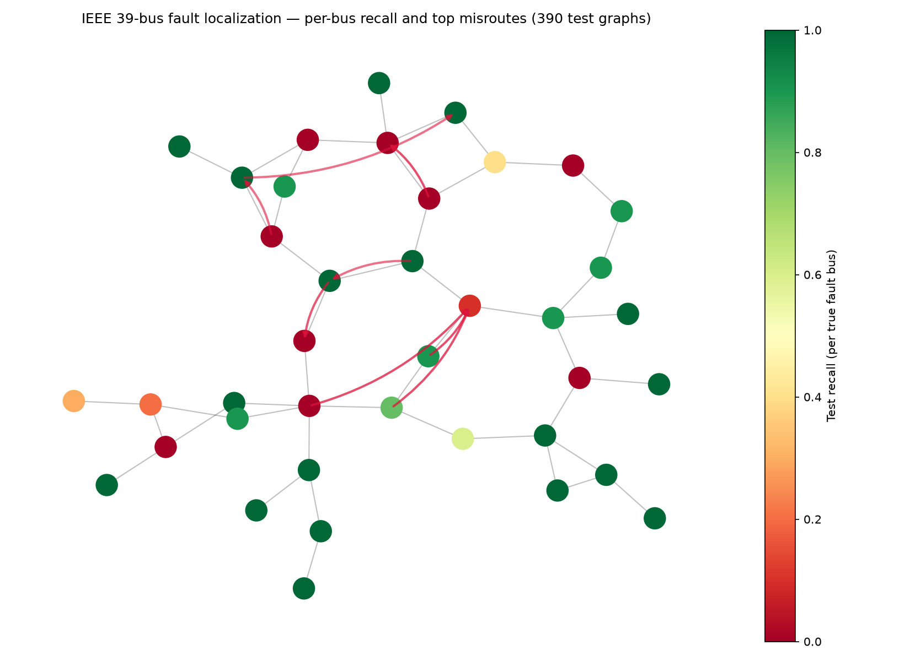

# grid-gnn-faults

**Graph-level fault localization** on the IEEE 39-bus test system: given pre-fault and during-fault voltages (and injections) on every bus, predict which bus hosted a three-phase bolted fault. Built with [pandapower](https://pandapower.readthedocs.io/) and [PyTorch Geometric](https://pytorch-geometric.readthedocs.io/).

Design and voltage method: [docs/GRID_FAULTS.md](docs/GRID_FAULTS.md). Status: [handover.md](handover.md).

## Quickstart

```powershell
python -m venv .venv
.\.venv\Scripts\Activate.ps1
pip install -e ".[dev,grid]"
pip install torch --index-url https://download.pytorch.org/whl/cpu  # if needed

python scripts/build_fault_dataset.py --out results --scenarios 50 --seed 0
python scripts/train_fault_gnn.py --data results --out results
pytest tests/test_grid_faults.py -q
```

Notebook: [notebooks/01_fault_localization_gnn.ipynb](notebooks/01_fault_localization_gnn.ipynb).

## Dataset

| Item | Value |
|------|-------|
| Graphs | 1,950 (50 operating scenarios × 39 buses) |
| Nodes | 39 buses (`net.bus.index` order) |
| Node features (8) | pre-fault `vm_pu`, during-fault `vm_pu`, ΔV, slack/PV/PQ one-hot, pre-fault `p_mw`, `q_mvar` |
| Label | Graph-level class 0…38 = faulted bus (`Data.y` shape `[1]`) |
| Split | Stratified 60/20/20 by faulted bus (seed 0) |
| During-fault V | Ybus bolted profile ([`src/grid/simulate.py`](src/grid/simulate.py)) |

Regenerate anytime with `scripts/build_fault_dataset.py`.

## Results (test split, seed 0)

| Model | Accuracy | Top-3 | Mean hop error | One random line out — accuracy | One line out — mean hops |
|-------|----------|-------|----------------|-------------------------------|---------------------------|
| Flattened MLP (39×8 → 128 → 39) | 0.956 | 0.982 | 0.059 | 0.956 (unchanged) | 0.059 |
| 2-layer GCN + global mean pool | 0.662 | 0.800 | 0.851 | 0.664 | 0.882 |

**Hop error** is the mean shortest-path distance on the undirected case39 graph between predicted and true fault bus (0 = exact bus). The MLP sees all buses at once and fits the Ybus voltage pattern well; this shallow GCN underperforms on clean data but is the model class that can use topology when features are incomplete or noisy. The robustness check drops one random branch per test graph **without** re-running power flow (node features stay fixed); the MLP is edge-blind by construction, so its scores do not move.



Min during-fault voltage (oracle on Ybus bolted faults): 100% accuracy — sanity check only, not a fair learned baseline ([docs/GRID_FAULTS.md](docs/GRID_FAULTS.md)).

## What this means for a TSO/DSO

After a fault, operators narrow **protection zones** and **crew dispatch** using voltage and SCADA from PMUs and RTUs. A classifier that is one **electrical hop** off still sends crews to the wrong bay; a prediction ten hops away is a different class of operational failure. Reporting **mean hop error** alongside top-1 and top-3 accuracy makes that distinction explicit. A graph model is the path toward **topology-aware** localization when measurements are missing or when a line outage changes flows — even though on this clean synthetic set the flattened MLP wins.

## Limitations

- Steady-state short-circuit voltages only (no transient or sequence components).
- No measurement noise, bad data, or PMU phasor dynamics.
- 39-bus toy; no market, protection, or reclosing logic.
- Edge-drop robustness does not re-simulate post-outage voltages.

## Next steps

Dynamic fault simulations (time-domain or sequence networks), **heterogeneous** graphs (transformers vs lines as distinct edge types), and **line-level** fault labels when the protection relay reports a zone rather than a bus.

---

## Also in this repo: gearbox RUL (Week 11 capstone)

Probabilistic gearbox **remaining useful life** on the Week 10 wind-turbine twin: LightGBM P10/P50/P90, MAPIE conformal intervals, leave-one-failure-out evaluation, TreeSHAP sensor rankings, and scripts that consume [wind-digital-twin](https://github.com/mehmetertac/wind-digital-twin) scored series.

```powershell
pip install -e ".[dev]"
python scripts/evaluate_quantile_rul.py --labeled path/to/daily_labeled.csv --out reports/rul
python scripts/explain_rul.py --labeled path/to/daily_labeled.csv --out results
```

RUL design: [docs/RUL_DESIGN.md](docs/RUL_DESIGN.md). Explanations: [docs/EXPLANATIONS.md](docs/EXPLANATIONS.md). Deployment API lives in [wind-digital-twin/service](https://github.com/mehmetertac/wind-digital-twin/tree/main/service).

## License

Apache-2.0 — see [LICENSE](LICENSE).
